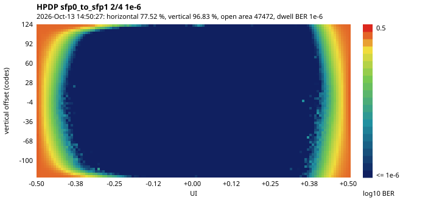

# HPDP project report

Hyperspectral Payload Data Processor: an FPGA emulation of the onboard data chain of a
hyperspectral Earth-observation satellite, on the AMD ZCU106 (Zynq UltraScale+ XCZU7EV-2).

| | |
|---|---|
| Report date | 2026-10-14 |
| Final builds | **m7h** (commit b506d30), `NX_MAX` 512: the board-tested build; **m7i_1024b** (commit d2eda42), `NX_MAX` 1024 (SYS-04, board-tested) |
| Specification | [SPEC.md](../SPEC.md) v1.0 |
| Milestone notes | [m0](m0_bringup.md), [m1](m1_models.md), [m2](m2_compressor.md), [m3](m3_frontend.md), [m4](m4_board_run.md), [m5](m5_downlink.md), [m6](m6_ground_station.md), [m7 plan](m7_plan.md), [m7 runbook](m7_board_runbook.md), [fault injection](m7_fault_injection.md); after M7: [UART console](console.md), [`NX_MAX` 1024](nx_max_1024.md), [real data](real_data.md) |

## 1. Summary

The HPDP takes raw pushbroom sensor data and runs the whole chain in the PL of the
XCZU7EV:

1. radiometric correction;
2. CCSDS 123.0-B-2 lossless compression;
3. CCSDS Space Packets and AOS frames;
4. Reed-Solomon (255,223) coding, randomization and sync markers;
5. a 1.25 Gbaud optical link over OM3 fiber;
6. a ground receiver whose output a PC ground station decodes back into the original
   image, bit for bit.

The PS runs a bare-metal application that configures and runs it.

Results on the board:

- **Throughput:** the reference mission rate (76.8 Msamples/s, 922 Mbit/s raw) for
  10 minutes with no dropped line (VER-08), on the final, radiation-mitigated build. The
  compressor alone runs at up to 250 Msamples/s.
- **Bit-exact end to end:** every scene reconstructed bit-exactly at the ground at
  injected BER 0, 10⁻⁴ and 10⁻³ (VER-07). The Reed-Solomon code holds to 2 × 10⁻³.
- **Compression on real data** (the RTL-exact model; five of the scenes also through the
  board, bit-exact at the ground): 63 public
  AVIRIS and Hyperion scenes, all lossless, at 4.4 – 6.0 bits per sample on average
  per dataset (2.3 – 3.1:1); at the mission rate the worst scene uses 71 % of the
  link (docs/real_data.md).
- **Link:** PRBS-31 over the fiber, 3.4 × 10¹² bits with 0 errors, so BER < 8.9 × 10⁻¹³
  at 95 % (VER-06). The eye scans are open in both directions (LNK-10).
- **Radiation mitigation:** SEM configuration scrubbing, ECC on every RAM, TMR on
  compressor state, configuration and control state, and pipeline and PS watchdogs.
  Configuration upsets were injected on the board and corrected within 153 ms. A
  1 300-trial simulated fault campaign found no silent corruption in protected state
  (RAD-01 … RAD-07).
- **Timing:** met on every clock; CDC and methodology clean with documented waivers
  (VER-09).

Status:

- 100 of 102 v1.0 *shall* / *should* requirements are met; none is unmet. The last one,
  SW-05 (the ground-record upload over Ethernet), was tested on the board on 2026-10-23:
  the records fetched over TCP identical to the JTAG copy, the scenes bit-exact at the
  ground station (docs/post_m7_board_tests.md §5).
- **2 are pending:** the independent CCSDS 123 decoder check (CMP-02, MDL-02) needs ESA /
  CNES tools (O-5). See §5.

## 2. System

```
PS DDR4 ─► AXI DMA ─► sensor emulator ─► radiometric ─► corner turn ─► scene guard ─► CCSDS 123
 (raw scenes,          (line timing,       correction     (BIL→BIP,      (short scenes    compressor
  calibration)          never stalls)      (dark, gain,    ping-pong       padded)        (1 sample/clk,
                                            bad pixels)    UltraRAM)                       250 MHz)
                                                                                              │
     ┌──── capture DMA ◄── fork ◄─────────────────────────────────────────────────────────────┘
     │                      │
     │                      └─► space packetizer ─► AOS framer ─► RS(255,223) I=4 ─► randomizer + ASM
     ▼                                                                                   │
  PS DDR4                       error injector ─► link layer (8b/10b) ─► GTH ══ OM3 fiber ══ GTH
                                                                                         │
  PC ground station ◄── TCP / file ◄── PS DDR4 ◄── ground DMA ◄── frame sync + derandomizer
  (RS decode, frames, packets,
   scenes, CCSDS 123 decoder,
   display, verification)
```

| Item | Value |
|---|---|
| Device / board | XCZU7EV-2 on the ZCU106; PS DDR4 SODIMM (x16, needs the DDR override of docs/m0) |
| Clocks | `clk_sys` 250 MHz (data path), `clk_sensor` 100 MHz (emulator), `clk_ctrl` 100 MHz (registers), `clk_link` 62.5 MHz (GTH user clock), `clk_fr` 31.25 MHz (free-running: GTH, SEM, debug hub) |
| Build-time maxima | `NX_MAX` 512 (1024 with `HPDP_NX_MAX`, SYS-04), `NZ_MAX` 256, `NZ_MIN` 16, `D_MAX` 16; `SYS.LIMITS` reports them |
| Registers | SystemRDL (`regs/hpdp.rdl`) → PeakRDL AXI4-Lite block in three voted copies; C, Python and SV headers generated |
| Software | `hpdp_run` (A53 #0, standalone, Vitis 2025.2) runs job blocks loaded over JTAG (job / result format v7), or scenes and tables from the SD card through a UART console ([console.md](console.md)); host tools `run_m4.py`, `run_m5.py`; ground station `hpdp_gs.py` |
| Models | `model/hpdp_model/`: bit-exact Python models of every block, which generate the RTL test vectors |

## 3. Results

### 3.1 Throughput

| Measurement | Result |
|---|---|
| VER-08 (m5, m7g and m7h builds): reference mission scene 512 × 256 × 150, D 12, 1 line per ms, 2344 scenes | 600.1 s at **76.8 Msamples/s**, 0 dropped lines, 0 underruns or overruns, 37.3 M science frames, 0 code errors, 0 sync losses; identical frame counts on all three builds |
| M4 capture runs | 98.8–99.8 Msamples/s, the emulator's maximum |
| Compressor capacity | 1 sample per clock at 250 MHz (250 Msamples/s) |
| SYS-09: RAW mode at the reference rate | the raw data exceeds the link, as required: 99.1 % of lines dropped and counted, every compressed scene that reached the compressor delivered |
| Link | about 857 Mbit/s of packet capacity; compressed data at the mission rate needs about 440 Mbit/s |

### 3.2 Compression

**Real data** ([real_data.md](real_data.md)): 63 public scenes through the compressor
model, which is bit-exact with the RTL on the whole VER-02 matrix; every scene decoded
and compared (63 of 63 lossless). Default settings; link use at the reference rate of
76.8 Msamples/s against 857 Mbit/s of packet capacity.

| Dataset | Scenes | Bits / sample, mean (range) | Ratio (D / bits) | Link use, mean (worst scene) |
|---|---|---|---|---|
| AVIRIS, airborne, 512 × 512 × 224, 2008 – 2017 | 49 | 4.43 (2.99 – 7.93) | 3.12:1 | 40 % (71 %) |
| Hyperion, EO-1 satellite, 256 × 1024 × 242, 2017 | 13 | 4.95 (4.74 – 5.16) | 2.86:1 | 44 % (46 %) |
| Indian Pines, AVIRIS, 145 × 145 × 220, 1992 | 1 | 6.01 | 2.33:1 | 54 % |

- CCSDS 123 needs 1.6 – 2.0 times fewer bits than deflate on the same samples.
- AVIRIS falls into two groups: 42 scenes at 3.91 bits/sample on average, and the 7
  scenes of three flights at 7.53.
- The default settings are within 1 % of the best setting tried on each dataset;
  without spectral prediction (P = 0) scenes need 12 – 67 % more bits.
- Scene length (O-7): 256-line scenes cost 0.3 % against whole images, 16-line scenes
  2 – 4 %; the default of 256 lines stands and O-7 is closed.
- On the board (2026-10-14, [post_m7_board_tests.md](post_m7_board_tests.md)): parts of
  two AVIRIS scenes, a Hyperion scene and Indian Pines on m7h, and a 1024-pixel Hyperion
  scene on m7i_1024b, compressed exactly as the model and rebuilt bit-exactly at the
  ground over the fiber; the AVIRIS ones also from the SD card through the console.

**Synthetic scenes** (bit-exact and decoded at the ground):

| Scene | Bits / sample | Ratio |
|---|---|---|
| 128 × 64 × 64, D 12, spectral mixture with noise | 5.92 | 2.03:1 |
| 512 × 256 × 150, D 12 (mission size) | – | 2.10:1 |
| 512 × 16 × 256, D 16, P 15 (build maximum) | 10.9–11.1 | 1.45:1 |
| ramp pattern, D 10 | 1.20 | 8.30:1 |
| LFSR pattern, D 14 (incompressible) | 14.50 | 0.97:1 |

### 3.3 Link and channel coding

| Test | Result |
|---|---|
| VER-06: PRBS-31 over the fiber, 2700 s | 3.375 × 10¹² bits, 0 errors: BER < 8.9 × 10⁻¹³ (95 %) |
| VER-07: scenes over the fiber | 4 / 4 scenes bit-exact at injected BER 0, 10⁻⁴ (1 432 RS symbols corrected), 10⁻³ (14 508 corrected) |
| BER sweep | 2 × 10⁻³: all corrected; 3 × 10⁻³: 1 uncorrectable codeblock, which costs only its own scene (SYS-06); ≥ 4 × 10⁻³: scenes lost. Expected range 3–5 × 10⁻³ |
| LNK-10: eye scans (In-System IBERT, increments 2/4, dwell BER 10⁻⁶; [docs/lnk10](lnk10/)) | SFP0 → SFP1: horizontal 77.5 %, vertical 96.8 %; SFP1 → SFP0: 77.5 % / 90.5 %; PRBS-31 meanwhile 1.1 × 10¹² bits, 0 errors |
| Ground station | RS decoding cross-checked against `reedsolo` on 7 088 codewords; 3.4 ms per codeblock and 2.5 s per 128 × 64 × 64 scene in pure Python |



### 3.4 Radiation mitigation (M7)

| Requirement | Mechanism | Board evidence |
|---|---|---|
| RAD-01 | `sem_ultra` in correction mode on `clk_fr`, ICAP handed over by `hpdp_run`, status and counters in the RAD block, injection from the PS | 251 configuration upsets: 198 corrected in 125–153 ms (one 154 ms scan of the configuration memory), 53 in masked or unused frames (undone), 0 uncorrectable; scenes bit-exact afterwards |
| RAD-02 | built-in ECC on all 56 UltraRAMs (calibration table, corner turn, line buffer), counters, injection | single-bit errors corrected (1 / 4 / 4 reads), double-bit errors detected |
| RAD-03 | weights in block RAM with ECC; coder and neighbourhood memories in voted LUT RAM; the register block in three voted copies | counters 0 in every run, including 10 minutes at the mission rate |
| RAD-04 | control state in three `DONT_TOUCH` copies, refreshed from the vote every cycle; extended in m7h to the steering state of the corner turn, packetizer and AOS framer | as above |
| RAD-05 | PL watchdogs (compressor, downlink, ground capture), PS watchdog per job | the PS watchdog reset the board when the app hung on purpose |
| RAD-06 | uncorrectable errors flag the scene's packet headers and raise an interrupt | flagged scenes seen by the ground station |
| RAD-07 | fault-injection campaign | simulation: 820 trials in protected state, **0 silent**; 22.5 % silent in the remaining unprotected datapath registers, accepted as residual risk; hardware: above |

The campaign drove a design change. In m7g, upsets in the corner turn's, packetizer's and
framer's address and count registers were silent 93–100 % of the time. Build m7h
triplicates them (+0.7 k LUT); after that, all 220 simulated upsets in them were corrected.

### 3.5 Implementation (m7h; m7i_1024b)

| | Result |
|---|---|
| Utilization | 38.2 k LUT (16.6 %), 39.2 k FF (8.5 %), 38.5 BRAM36 (12.3 %), 56 URAM (58.3 %), 24 DSP (1.4 %), 2 GTHE4 |
| m7i_1024b (`NX_MAX` 1024, SYS-04; [note](nx_max_1024.md); board-tested) | 38.9 k LUT, 40.1 k FF, 46.5 BRAM36, **80 URAM (83.3 %)**, 24 DSP; timing met on all clocks, setup WNS +0.012 ns (`clk_sys`), hold WHS +0.010 ns, bus skew worst +2.85 ns; `report_cdc` and `report_methodology` identical to m7h |
| Timing (VER-09) | met on all 11 clocks: setup WNS +0.087 ns (`clk_sys` 250 MHz), hold WHS +0.010 ns; 36 `set_bus_skew` constraints met (worst slack +2.94 ns); `check_timing` clean apart from the two static SFP `TX_DISABLE_B` outputs (false path) |
| `report_cdc` | 0 unsafe, 0 unknown crossings. Waived: CDC-11 in the GTH wizard (2 endpoints, one monotonic "active" flag into two reset synchronizers; `vivado/constraints/waivers.xdc`). The remaining Warning rows are safe (the wizard's CPLL-calibration false paths; `clk_sensor` → `clk_pl_1` with max-delay constraints) |
| `report_methodology` | 5 × LUTAR-1 waived (GTH wizard reset structure, as AMD's example design); 2 advisories on the `clk_sensor` MMCM (CLKC-40 / CLKC-56, could be a PLL; no LOC) |

## 4. Verification

| Level | What |
|---|---|
| Python models | 150 pytest tests: CCSDS 123 encoder / decoder round trips over 20 configurations and D ∈ {2 … 16}, RS against `reedsolo`, framing, frame sync, end-to-end chain |
| RTL regression | 87 self-checking xsim tests from model vectors with random stalls, run headless by `tb/run_sim.tcl` in 9 minutes (VER-01, VER-10): 28 chosen compressor configurations, the corner-case images (all zero, all maximum at D 12 and 16; VER-03) and 6 random configurations of the matrix (seed printed); front end, also with the calibration table in pairs; downlink and ground blocks; link layer; system tests through the registers (VER-05), one at the 1024 build's size; ECC, TMR, watchdog and SEM-path tests; the fault campaign (3 trials per class, and 10 per table ECC class in pairs) |
| Configuration matrix (VER-02) | all 864 compressor configurations of SPEC VER-02 (local sum 4 × prediction mode 2 × P 4 × D 3 × Ω 3 × U_max 3), `HPDP_C123_MATRIX=all`: **864 of 864 bit-exact**, 57 minutes (2026-10-14) |
| Fault campaign | `tb_fault`, 1 300 trials on m7h (`docs/m7_fault_injection.md`) |
| Ground station | `pytest sw/ground` (decoder, reports) and three board captures decoded |
| Board | M0 DMA loopback (3 865 MB/s); M4 15 scenes; M5 VER-06 / 07 / 08 and SYS-09; M7 runbook (`docs/m7_board_runbook.md`, results section); post-M7: real scenes, the 1024 build, SD card and console, the Ethernet upload (`docs/post_m7_board_tests.md`); all JTAG-only, flash untouched |

## 5. Requirements compliance

Status of every v1.0 requirement in SPEC. *may* items and the v1.1 item are listed
separately.

| Area | Met | Not fully met |
|---|---|---|
| System (SYS-01 … 10) | all; SYS-04 by build m7i_1024b ([note](nx_max_1024.md)) | – |
| Sensor emulator (SE-01 … 06) | all | – |
| Radiometric correction (RC-01 … 05) | all | – |
| Corner turn (CT-01 … 04) | all | – |
| Compressor (CMP-01, 03 … 09) | all | **CMP-02**: no independent CCSDS 123 decoder yet (O-5) |
| Packetizer, AOS framer (PKT, AOS) | all | – |
| Channel coding (CC-01 … 06) | all; CC-06 cross-checked with `reedsolo` instead of libfec | – |
| Error injector (EI-01 … 04) | all | – |
| Link (LNK-01 … 10) | all, including LNK-10 (*should*) | – |
| Ground receiver (GR-01, 03 … 05; GR-02 byte-aligned) | all | – |
| Data movement (DM-01 … 03) | all | – |
| PS software (SW-01 … 06) | all; SW-02 and SW-04 on the board 2026-10-14 ([console.md](console.md)); SW-05's TCP upload on the board 2026-10-23 ([runbook](post_m7_board_tests.md) §5) | – |
| Ground station (GS-01 … 06) | all; GS-02 cross-checked with `reedsolo` instead of libfec | – |
| Models (MDL-01 … 04) | 01, 03, 04 | **MDL-02**: cross-validation against an independent decoder (O-5) |
| Radiation (RAD-01 … 07) | all | – |
| Verification (VER-01 … 10) | all; VER-04 with `reedsolo`; VER-02: a random subset in every regression and the full matrix by one command (no scheduler runs it nightly) | – |

Other items:

- *may*, not done: RC-06 (double-buffered tables), CMP-11 (near-lossless at full rate),
  CMP-12 (hybrid entropy coder), GR-06 (hardware RS decoder), bit-level frame sync
  (GR-02), the C / numba decoder (GS-04).
- v1.1, not done: CMP-10 (near-lossless).

## 6. Deviations and decisions

| Item | What and why |
|---|---|
| Job interface first, console later (SW-02, SW-04) | Since M4 the host builds each job (scenes, tables, settings) and loads it over JTAG together with the bitstream and the app; the app prints a summary and returns a result block that the host checks bit for bit. This made every board run reproducible and self-checking. The SD card loading and UART console came after M7 (2026-10-14): the console posts the same job block, so both paths share the app's checks |
| `reedsolo` instead of libfec (CC-06, GS-02, VER-04) | An independent RS implementation in Python, with the same field and roots, available without building libfec on Windows |
| Calibration table layouts (M7, SYS-04) | Layout A, one entry per 64-bit word, up to 512 × 256 (the user's choice); layout B, two entries' dark and gain per word and the bad flags apart, above it, so that `NX_MAX` 1024 fits in 80 of 96 UltraRAMs |
| Test data (SPEC §11) | Indian Pines, and the GICI (Universitat Autònoma de Barcelona) test sets of 49 AVIRIS and 13 Hyperion scenes in place of Salinas and Pavia University: their usual source refuses this network and has no official mirror, and the CCSDS corpus is behind a login |
| SYS-09 RAW overload: option (a) | RAW mode shows that raw data exceeds the link; whole scenes are not dropped on purpose (docs/m7_plan.md decision 1) |
| Scene guard | A scene cut short is padded and ended, so one lost line cannot merge scenes (found in M5) |
| PS watchdog per job | Armed by a job flag, so debugging that halts the processor is not reset |
| TMR on the steering state (m7h) | Found by the fault campaign (above) |
| Residual risk | Upsets in datapath registers are silent about one time in four in simulation; accepted (docs/m7_fault_injection.md) |
| Project folder self-contained | The Vitis workspace (`vitis/`), board runs (`build/runs/`) and the venv (`.venv/`) are inside the repository; tools that fail on the space in the path reach them through directory junctions (docs/m0, issue 3) |

## 7. Open items

| Item | Needs | Effort |
|---|---|---|
| CMP-02 / MDL-02 / O-5: independent CCSDS 123 decoder | an account: ESA's WhiteDwarf 2.0 (ESSR, essr.esa.int/project/whitedwarf-2-0) includes a 123.0-B-2 decompressor in source, ESA Community Licence v2.4 permissive (type 3); or CNES's object-code compressor and decompressor (connectbycnes.fr). Then decode the RTL test vectors and the real-data scenes with it | half a day once available |

Stretch goals (SPEC §15) are untouched. The return channel is now possible: the cable
is duplex (O-1).

## 8. Reproducing

```
python -m pytest model                                   # Python models
python -I model/hpdp_datasets.py experiment -j 5         # real-data compression (data: docs/real_data.md)
vivado -mode batch -source tb/run_sim.tcl                # RTL regression (87 tests)
vivado -mode batch -source tb/run_sim.tcl -tclargs "c123_mx_*"   # with HPDP_C123_MATRIX=all: the VER-02 matrix
vivado -mode batch -source vivado/build.tcl              # bitstream + XSA (HPDP_BUILD_DIR, default build/;
                                                         #   HPDP_NX_MAX=1024 for the SYS-04 build)
vitis -s sw/baremetal/build.py build/m7h/hpdp.xsa        # app, workspace vitis/
python sw/host/run_m5.py --work <name>                   # a board run, JTAG only (build/runs/<name>)
python sw/ground/hpdp_gs.py decode build/runs/<name>/gr.bin --ref build/runs/<name> --show
```

The board procedure for each milestone is in its notes; M7's is in
[docs/m7_board_runbook.md](m7_board_runbook.md).
